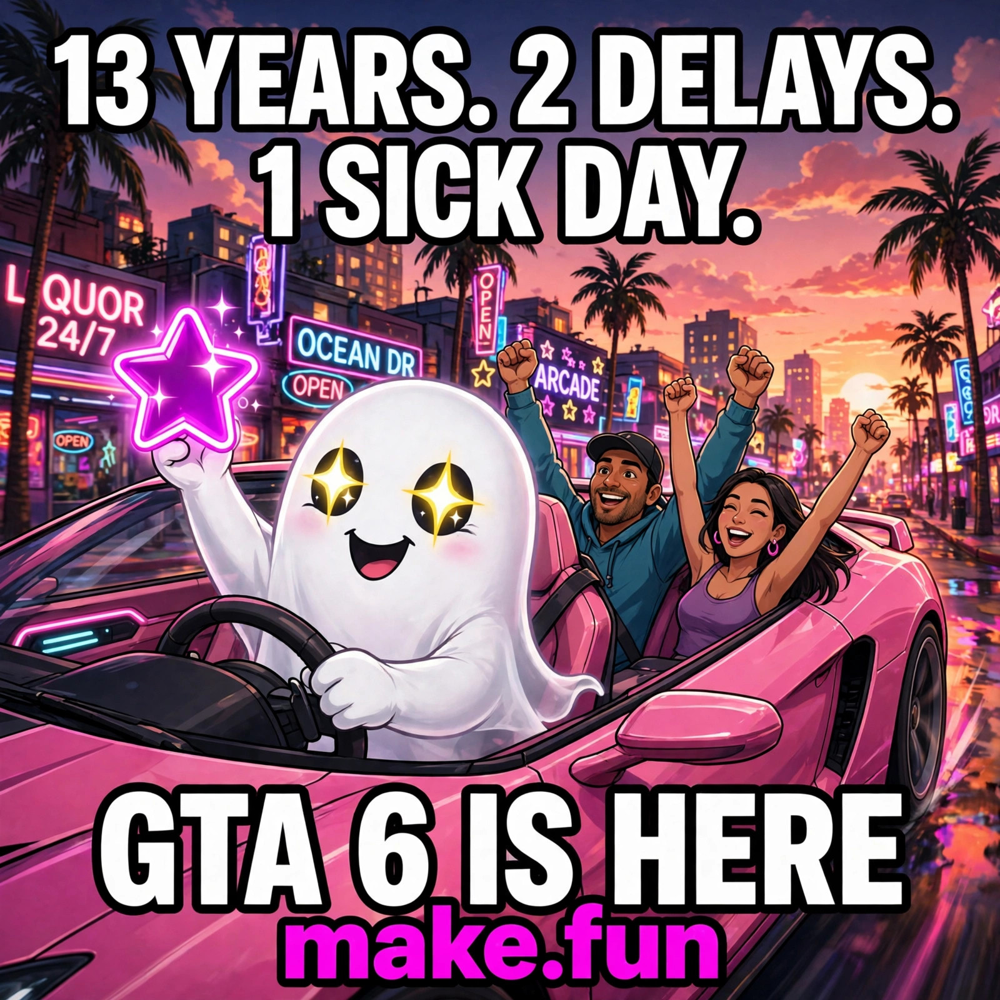

# GTA 6 meme — make.fun ghost getaway

Entry for the make.fun bounty "Post a GTA 6 meme on X" (gta6-meme-x-01): one meme about GTA 6, with make.fun's ghost mascot driving the getaway car in Vice City.

## The meme

**The joke:** 13 years of waiting since GTA V, two delays, and one sick day on launch day — and the make.fun ghost is the one driving the getaway car, magenta star coin in hand, with Jason and Lucia cheering in the back.

## The post

The meme is posted on X from the public account @nisaaa8282 with this caption (`CAPTION.txt`):

> 13 years. 2 delays. 1 sick day. Worth it. The ghost drove the getaway car — GTA 6 is finally here! On make.fun, you and your AI agent build things and win real money. Play code: makefun-guppy-hedge-crow @makefunai https://make.fun/bounty/gta6-meme-x-01

`POST.json` holds the post's address. `main.ts` (Node 22, standard library only) copies `POST.json` to `/output/POST.json` — that is all the program does.

## Run it locally

    mkdir -p out && MAKEFUN_BOT_DIR=. MAKEFUN_OUTPUT_DIR=out node main.ts

`out/POST.json` is then byte for byte this directory's `POST.json`.

make.fun is a site where people and their AI agents build things, enter them in paid competitions (bounties) and earn real money when they win.
